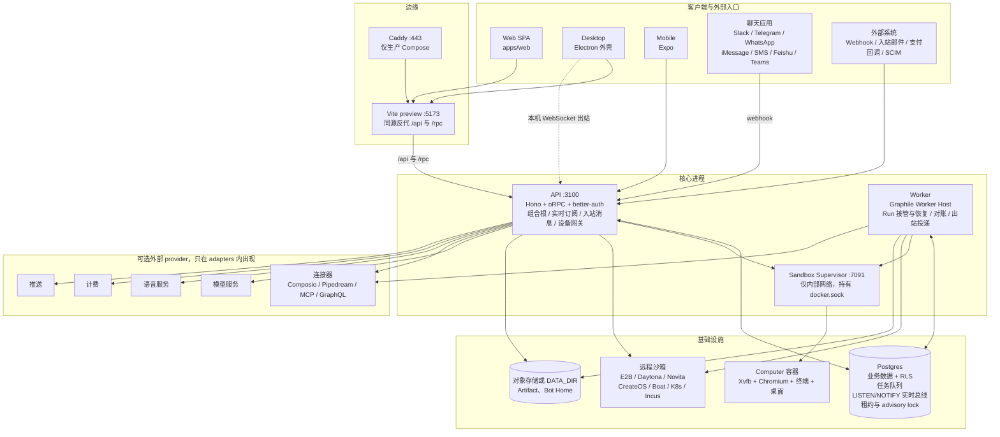
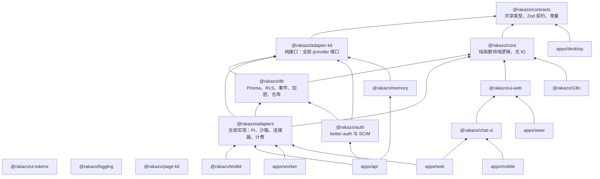
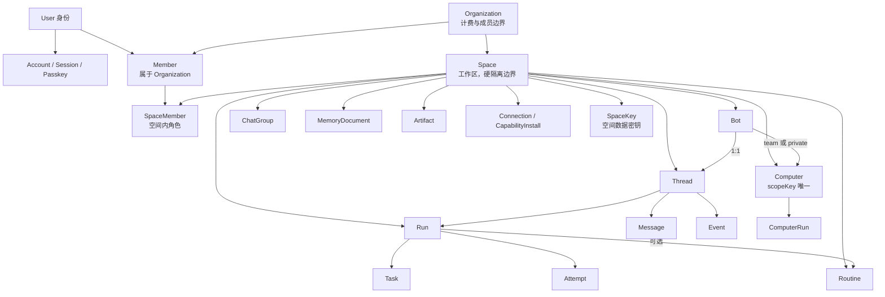
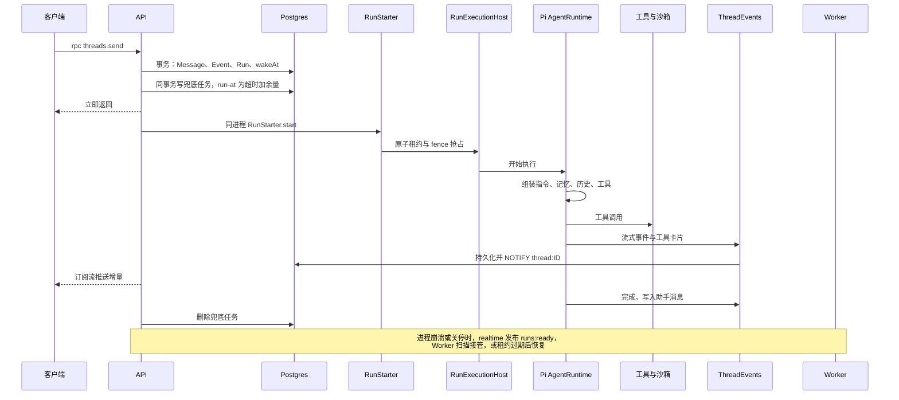
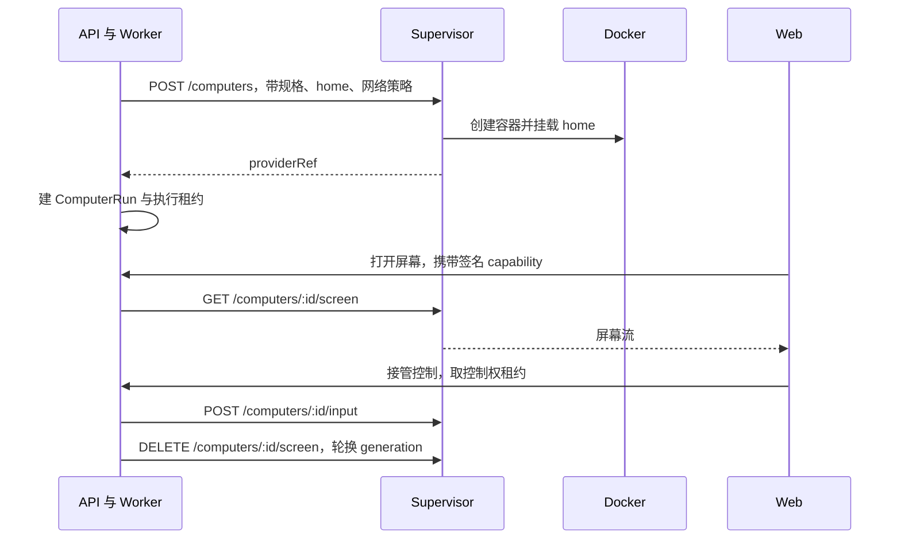
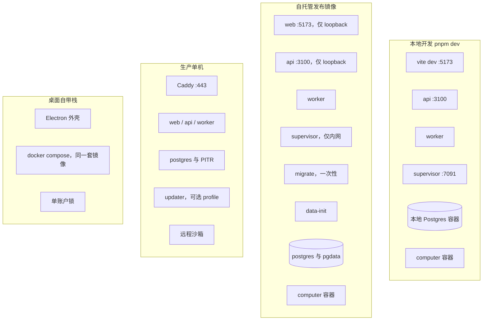

# 架构总览：运行时拓扑与业务边界

本文是给开发者看的架构导读，不是用户指南。它回答四个问题：系统由哪些进程和基础设施组成、代码如何分层、业务被切成哪些域、哪些边界不可以越过。

范围：`main` 分支（`v0.11.0` 之后的 edge）。模型 128 个、迁移 273 个、provider 端口 31 个，规模会变，结论相对稳定。

相关文档：

- [Run 调度与响应时序](./run-execution.md)
- [计算机运行时](./computer-runtime.md)
- [空间](./spaces.md)
- [内容加密](./content-encryption.md)
- [自托管](./self-host.md)

---

## 1. 一句话定位

Rakazo 是一个多租户的“常驻 AI 同事”平台。每个 Bot 拥有持续的对话、记忆、指令和一台真实计算机，能按计划、按事件、按聊天消息自主运行；模型、沙箱、连接器、消息渠道、计费和存储都通过一组 provider-neutral 端口接入。

技术形态不是“一个 Web 应用”，而是：

> 一个长驻 API + 一个队列与对账 Worker + Postgres + 一个计算机控制面 + 多端客户端。

---

## 2. 运行时全景



### 四个容易误解的点

| 事实 | 含义 |
| --- | --- |
| Agent 运行时（Pi）跑在 API/Worker 进程内，不在沙箱里 | 沙箱只是“手和眼”；模型调用、工具编排、审批都在 Node 进程 |
| Run 不经过队列启动 | 谁让 Run 到期，谁就在本进程立刻起一个独立任务；队列只做崩溃兜底 |
| Postgres 同时是四样东西 | 业务库、任务队列、实时消息总线、分布式锁与租约 |
| Web 与 API 同源 | 生产由 Vite preview 反代 `/api` 与 `/rpc`，只暴露 5173，不暴露 3100 |

---

## 3. 进程与职责

| 组件 | 目录 | 职责 | 不负责 |
| --- | --- | --- | --- |
| API | `apps/api` | HTTP 入口、oRPC 路由、认证与会话、实时订阅、入站消息轮询、设备网关、屏幕代理、Webhook、SCIM、计费回调 | 长期后台任务、跨副本对账 |
| Worker | `apps/worker` | Graphile 任务宿主、Run 接管与恢复、对账 leadership、出站消息投递、通知、记忆任务 | 入站轮询、HTTP 请求处理 |
| Web | `apps/web` | React SPA；开发用 Vite dev，生产用 Vite preview | 业务规则 |
| Desktop | `apps/desktop` | Electron 外壳，托管 Web UI；自动更新；本机 Docker 栈管理；宿主电脑桥接 | 独立业务逻辑 |
| Mobile | `apps/mobile` | Expo Router 原生客户端，共享同一 API | 独立后端 |
| Marketing | `apps/www` | Astro 站点，可独立托管 | 产品运行时 |
| Supervisor | `infra/sandboxes/supervisor` | Docker 计算机控制面：创建、执行、浏览器、观察、文件、屏幕、终端、输入、停止、删除 | 业务授权 |
| Computer 镜像 | `infra/sandboxes/computer` | Debian + Xvfb + fluxbox + Chromium + 页面助手 + 截屏 | 模型调用 |
| Updater | `infra/updater` | 可选 profile 的 root 级自更新边车 | 默认部署路径 |

---

## 4. 代码分层



依赖方向是单向的：

```text
contracts ← core ← db ← adapters ← apps
              ↑
        adapter-kit（只有接口）
```

- `contracts`、`core`、`adapter-kit` 不依赖任何基础设施。
- `db` 可以实现 `adapter-kit` 的端口，`adapters` 不能反向依赖 `apps`。
- 厂商名只允许出现在 `packages/adapters` 与 `infra/`；共享契约、设置、数据库列、路由、UI 文案都不出现厂商名，即使当前只有一个实现。

两个组合根值得先读：`apps/api/src/app.ts` 与 `apps/worker/src/index.ts`。所有适配器在这两个文件里被选中、配置并注入，读它们等于读一遍“系统由什么拼成”。

---

## 5. 业务域边界

### 5.1 域地图

```mermaid
flowchart LR
  subgraph identity["身份与租户"]
    A1["认证 / 会话 / Passkey / OIDC"]
    A2["组织与成员"]
    A3["空间与成员角色"]
    A4["SCIM 目录同步"]
  end

  subgraph conversation["对话与执行"]
    B1["Bot / 分组 / 线程"]
    B2["Run / Task / Attempt"]
    B3["审批与自动审查"]
    B4["计划任务 Routine / Webhook"]
  end

  subgraph capability["能力面"]
    C1["计算机与屏幕控制"]
    C2["记忆与便签"]
    C3["技能 / 插件 / MCP"]
    C4["连接器与 OAuth"]
    C5["页面 / 看板 / 产物"]
    C6["语音与通话"]
  end

  subgraph trust["信任与商业"]
    D1["凭据保险库"]
    D2["模型连接与额度"]
    D3["计费 / 订阅 / 推荐"]
    D4["审计 / 安全事件 / 导出"]
  end

  subgraph delivery["交付面"]
    E1["消息渠道"]
    E2["通知与实时事件"]
    E3["邮件"]
  end

  identity --> conversation
  conversation --> capability
  conversation --> delivery
  capability --> trust
  delivery --> trust
```



### 5.2 域职责表

| 域 | 职责 | 主要入口 | 关键数据 |
| --- | --- | --- | --- |
| 身份与认证 | 登录、会话、Passkey、OIDC、找回密码、账户安全 | `apps/api/src/app.ts`、`@rakazo/auth` | `User`、`Account`、`Session`、`Passkey` |
| 组织与空间 | 租户层级、邀请、角色、空间设置继承 | `routes/spaces.ts`、`routes/organizations.ts`、`db/spaces.ts` | `Organization`、`Member`、`Space`、`SpaceMember`、`SpaceKey` |
| Bot 与对话 | Bot 生命周期、单线程会话、分组、消息、读态 | `routes/bots.ts`、`routes/threads.ts` | `Bot`、`Thread`、`Message`、`Event`、`ChatGroup` |
| Run 执行 | 触发、租约、心跳、恢复、取消、重试、计时 | `packages/adapters/src/run-*.ts` | `Run`、`Task`、`Attempt`、`SteeringMessage` |
| 计算机运行时 | 沙箱生命周期、屏幕、浏览器、文件、终端、控制权 | `packages/adapters/src/computer-*.ts`、`infra/sandboxes/*` | `Computer`、`ComputerRun`、`ComputerExecutionLease`、`AgentHome` |
| 记忆 | 每 Bot 笔记、共享记忆、语义记忆 provider、历史压缩 | `@rakazo/memory`、`routes/memory.ts` | `MemoryDocument`、`MemoryRevision`、`SpaceMemoryConfig` |
| 自动化 | 定时与事件触发、Webhook、看板工单 | `routes/routines.ts`、`routes/boards.ts` | `Routine`、`Board`、`Ticket`、`TicketComment` |
| 集成 | 连接器目录、OAuth、MCP server、插件安装、能力开关 | `routes/connections.ts`、`routes/mcp.ts`、`routes/capabilities.ts` | `Connection`、`McpServer`、`CapabilityInstall` |
| 消息渠道 | 渠道绑定、入站消息、出站投递、群聊身份 | `apps/api/src/messaging-runtime.ts`、`routes/messaging.ts` | `MessagingInstallation`、`MessagingChannel`、`MessagingIdentity`、`MessagingOutbound` |
| 内容面 | 页面、版本、公开分享、产物、搜索 | `routes/pages.ts`、`routes/content.ts` | `Page`、`PageVersion`、`Artifact` |
| 凭据保险库 | 登录、银行卡、API key、OTP；按 Bot 授权与限额 | `packages/adapters/src/bot-secrets.ts` | `VaultCredential`、`VaultCredentialBot`、`VaultCredentialLimit` |
| 模型与额度 | BYOK、模型角色、部署模型、额度账户与流水 | `routes/models.ts`、`packages/adapters/src/model-*.ts` | `UserModelCredential`、`ModelCreditAccount`、`ModelCreditEntry`、`UsageRecord` |
| 商业 | 订阅、一次性购买、支付钱包、消费上限、推荐 | `apps/api/src/billing.ts`、`routes/spending-limit.ts` | `BillingAccount`、`Purchase`、`Payment`、`SpendingLimit` |
| 运维与合规 | 审计、安全事件、账号导出、数据同意、部署设置、监控 | `apps/api/src/audit-export.ts`、`monitoring.ts` | `AuditEvent`、`SecurityEvent`、`DeploymentSettings`、`AiDataConsent` |
| 语音与通话 | TTS/STT provider、语音设置、来电与通话会话 | `apps/api/src/voice.ts`、`routes/account.ts` | `UserVoiceCredential`、`CallPushDevice` |
| 通知与实时 | 流式订阅、推送、活动卡片、未读 | `packages/adapters/src/realtime.ts`、`run-notifications.ts` | `PushToken`、`WorkActivityToken` |
| 邮件 | 账户邮件、Bot 自有邮箱、入站邮件解析 | `apps/api/src/email*.ts` | `BotEmailAddress`、`BotEmailMessage`、`BotEmailSend` |

路由层的 17 组 oRPC 命名空间与上表基本一一对应，见 `apps/api/src/router.ts`。

---

## 6. 数据边界与隔离

### 6.1 租户层级



三层含义不同，不要混用：

- `Organization` 是计费与成员边界，一人一组织是常见形态。
- `Space` 是真正的隔离边界：Bot、会话、记忆、文件、连接、凭据、计算机都在空间内。
- `Thread` 是会话边界，`Run` 是一次执行边界，`Task` 是一次可交付工作边界。

### 6.2 四道隔离机制

| 机制 | 实现 | 作用 |
| --- | --- | --- |
| 行级安全 | `@rakazo/db` 的 `runAsTenant` 与 `runAsSystem`，会话变量携带 `spaceId` | 即使代码写错过滤条件，也读不到别的空间 |
| 信封加密 | 每空间 `space_keys`，由 master key 包裹；附加认证数据绑定表、列、行、空间 | 拷走的密文换行换表就解不开 |
| 存储分区 | `DATA_DIR/artifacts/<space>/…`、`homes/<id>/<rev>`、对象存储前缀 | 文件层面不串空间 |
| 运行时作用域 | `Computer.scopeKey`、`ComputerExecutionLease`、`screenGeneration` | 同一台计算机同时只有一个执行者与控制者 |

唯一的 RLS 绕过口是 `runAsSystem`，只用于认证路由、Webhook 和 Worker 的跨租户工作。它是全局少数的显式例外，新增用途需要理由。

---

## 7. 关键链路

### 7.1 一次 Agent Run



文本版：

```text
HTTP / oRPC（API 进程）                      Graphile（只做兜底）
   │ 提交消息、问候或答复
   ▼
RunJobPublisher ── 写 Run.wakeAt ──────────► 备份任务，run-at 为超时加余量
   │ 同进程立即开始
   ▼
RunStarter ─► 租约与 fence 准入 ─► Pi AgentRuntime
                                  ├─ 模型流
                                  ├─ 工具 ─► SandboxProvider ─► Computer
                                  └─ 事件 ─► ThreadEvents ─► NOTIFY ─► 客户端
```

设计要点：

- 队列不是主路径。不能在 Run 前面加队列、槽位或轮询。
- `leaseOwner` 与 `leaseFence` 保证多副本下只执行一次。
- 关闭或内存不足时交棒给其他进程，而不是等租约超时。
- Worker 负责接管、恢复、对账、兜底，不是执行主力。

### 7.2 Routine 触发

```text
Graphile 定时任务 routine.wakeup
  → 建 Run，trigger 为 routine
  → 记 wakeAt 并立即启动
  → 结果回到同一 Thread
  → 失败走 routine.retry，有上限，耗尽后发通知
```

### 7.3 入站聊天消息

```text
Slack / Telegram / 其他 webhook → API（唯一入站消费者）
  → 校验签名，解析安装与身份
  → 落 ExternalMessage 并映射到 Thread
  → 建 Run，trigger 为 messaging
  → RunStarter 执行
  → 回复经 messaging.reply → MessagingOutbound → messaging.send
```

明确约束：Telegram 的 `getUpdates` 只允许一个消费者，所以入站轮询只在 API，Worker 只做出站投递。这条约束写在 `apps/worker/src/index.ts` 的注释里。

### 7.4 计算机生命周期



边界：

- 屏幕链接用 `SCREEN_PROXY_SECRET` 签名，`screenGeneration` 变化即失效。
- 计算机分 Team 与 Private：Team 共享文件与工具，每个 Bot 独立屏幕与浏览器；Private 独占。
- 空闲自动休眠；`computer.sleep`、`computer.control-expire`、`computer.update` 都是队列里的显式任务。

### 7.5 桌面“用我这台电脑”

```text
Desktop 出站 WebSocket → API 的 UserDeviceHub（不需要入站端口）
API 内部转发 → Worker（USER_DEVICE_FORWARD_SECRET）
Worker 的 desktop 或 host-aware SandboxProvider 把命令与截图送回 Desktop
```

代价是设备必须在线。

---

## 8. 扩展点：provider 端口

`packages/adapter-kit/src/interfaces.ts` 是全项目的“架构目录”。换实现只改这里。

| 端口 | 职责 | 现有实现方向 |
| --- | --- | --- |
| `SandboxProvider` | 计算机生命周期与操作 | docker、e2b、daytona、novita、createos、boat、kubernetes、incus、railway、desktop、host-aware、none、fake |
| `AgentRuntime` | 模型与工具循环 | `PiAgentRuntime`、`ScriptedAgentRuntime` |
| `ConnectorProvider`、`ManagedConnectorProvider` | 第三方应用动作 | Composio、Pipedream、MCP、GraphQL、插件连接器 |
| `MemoryStore`、`SemanticMemoryProvider` | 文件式与语义记忆 | Markdown store、Hindsight、Honcho、Supermemory、Serenity |
| `WebProvider`、`BrowserProvider` | 搜索、抓取、浏览器动作 | OpenRouter web、Parallel、Keenable、浏览器模拟器 |
| `VoiceProvider` | 语音合成与转写 | ElevenLabs、OpenAI、Cartesia、Fish、xAI、macOS |
| `MessagingSurface` | 聊天渠道 | Slack、Telegram、WhatsApp、iMessage、SMS、Feishu、Teams |
| `NotificationProvider` | 推送 | Expo、APNs |
| `TransactionalEmailProvider` | 邮件 | SMTP、Resend、模拟器 |
| `BillingProvider` | 订阅与购买 | Stripe |
| `SecretStore`、`KeyProvider`、`ObjectStorage` | 密钥、主密钥、对象存储 | 环境变量、KMS、Infisical、本地与对象存储 |
| `JobPublisher`、`JobWorkerHost` | 任务 | Graphile、内存实现 |
| `RealtimeFanout` | 跨进程事件 | Postgres 的 LISTEN/NOTIFY、内存实现 |
| `AgentHomeStore`、`ArtifactStore` | 工作区与产物 | 本地磁盘、对象存储 |
| `AutoReviewProvider` | 审批的自动模式 | Jev、脚本实现 |

扩展规则：新增厂商 = 在 `adapters` 加实现 + 在组合根装配 + 加离线一致性测试。不要在共享契约、数据库、UI 里加厂商分支。

---

## 9. 部署拓扑



| 形态 | 适用 | 特点 |
| --- | --- | --- |
| 本地开发 | 日常开发 | 端口自动挑选；分支有独有迁移时用独立数据库；启动时生成 Prisma Client 并跑迁移 |
| 发布镜像 | 自托管 | 全部来自 GHCR；`RAKAZO_IMAGE_TAG` 可选 edge 或版本；缺少 `SANDBOX_SUPERVISOR_TOKEN` 即启动失败 |
| 生产单机 | 公网 | Caddy 自动 TLS、主机加固、PITR、可选 root 级 updater；默认远程沙箱 |
| 桌面自带栈 | 单机自用 | 云端、本机 Docker、连接已有实例三种模式；本机栈在退出应用后仍运行，保证 Routine 继续 |

多副本原则：API 与 Worker 都可水平扩，协调只靠 Postgres 的租约、advisory lock、对账 leadership 与 NOTIFY，没有进程内单点状态。

滚动发布兼容：数据库迁移必须兼容上一版代码仍在运行的几秒到几分钟。删除类迁移首行写 `-- deferred`，推迟一次部署生效。

---

## 10. 不可以越过的边界

1. Space 是硬边界。跨空间共享要么有显式开关，要么不做。
2. Run 不许排队。到期即在本进程启动；队列只做崩溃兜底，且必须带 job key 与 run-at。
3. 前端只表达意图。授权、校验、重试、恢复、provider 选择都在后端；前端不拼 provider 请求。
4. 厂商名不外泄。共享契约、设置项、数据库列、路由、UI 文案都不出现具体厂商。
5. 可选重依赖必须动态 `import()`。没配置就不加载。
6. 内容加密的附加认证数据不能省。新增需加密字段要同时改读写与迁移。
7. 迁移兼容上一 release。删除走 deferred 两阶段。
8. 审批是安全边界。读外部内容后权限降级、暂停后恢复、非本人消息触发的 Run 都要重新征求。
9. 凭据不进模型上下文。保险库的值只在工具执行时注入，卡片、事件、日志都要脱敏。
10. 测试默认离线确定性。用脚本运行时与假沙箱；真实 provider 的测试要 opt-in。

---

## 11. 阅读地图

按这个顺序建立心智最快：

| 顺序 | 文件 | 看什么 |
| --- | --- | --- |
| 1 | `docs/run-execution.md` | Run 为什么不排队、如何交棒与恢复 |
| 2 | `packages/adapter-kit/src/interfaces.ts` | 全部业务端口 |
| 3 | `apps/api/src/app.ts` | 组合根：适配器如何被选中并注入 |
| 4 | `apps/api/src/router.ts` | 17 组路由即 17 个业务域 |
| 5 | `apps/worker/src/index.ts` | 后台任务与对账的真实清单 |
| 6 | `packages/adapters/src/background-job-handlers.ts` | 任务名与归属 |
| 7 | `packages/adapters/src/run-wakeup.ts` | 启动、交棒、接管 |
| 8 | `docs/computer-runtime.md` 与 `infra/sandboxes/supervisor/src/routes.ts` | 计算机控制面 |
| 9 | `packages/db/prisma/schema.prisma` | 模型关系与唯一约束 |
| 10 | `docs/spaces.md` 与 `docs/content-encryption.md` | 隔离与加密的真实边界 |

---

## 12. 术语

| 术语 | 含义 |
| --- | --- |
| Space | 工作区，硬隔离边界，拥有自己的 Bot、会话、记忆、文件、连接与计算机 |
| Bot | 一个常驻同事，拥有唯一会话线程、指令、记忆与计算机 |
| Thread | 会话；Bot、分组、外部会话各对应一个线程 |
| Run | 一次执行，带租约、fence、状态与恢复点 |
| Task | 一次可交付工作，可包含多个 Run 与 Attempt |
| Computer | 沙箱实例，team 或 private；有两种控制权：执行租约与屏幕控制租约 |
| Home | Bot 计算机的工作区持久化版本 |
| Artifact | Bot 产出并保存在 Rakazo 的文件 |
| Skill | 写给 Bot 看的操作知识，不执行随附脚本 |
| Plugin | 描述 MCP 连接的清单，Rakazo 只读文件，不运行仓库代码 |
| Connector | 第三方应用的动作通道 |
| Vault | 凭据保险库，按 Bot 授权，可限额并记录使用 |
| Handover | 进程无法继续时把 Run 交给其他进程，而不是等超时 |

---

## 维护说明

本文描述结构而非细节，代码变动时优先更新图中的节点与第 10 节的边界清单；具体行为以 `docs/` 下的专项文档和源码为准。
